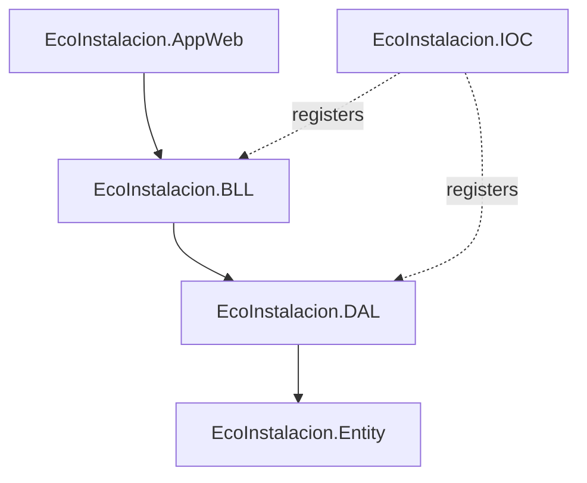

# Layered Architecture

The project is structured following a classic N-Tier (Layered) Architecture. This separation of concerns ensures that presentation logic, business logic, and data persistence remain physically and semantically decoupled.



---

## Solution Structure

### 1. Presentation Layer (`EcoInstalacion.AppWeb`)
- **Technology**: ASP.NET Core MVC / Razor Views.
- **Responsibilities**: Maps incoming HTTP requests to controllers, returns HTML/Razor views or JSON responses, handles web configuration (`appsettings.json`, `Program.cs`), and manages user sessions and cookie-based authentication.
- **Rules**: Must remain thin. No direct SQL queries, business logic, or EF Core imports. Consumes BLL services via Dependency Injection.

### 2. Business Logic Layer (`EcoInstalacion.BLL`)
- **Technology**: Plain C# Class Library (.NET 8).
- **Responsibilities**: Orchestrates business workflows, validates domain inputs, applies default values, checks logical constraints (e.g., preventing duplicate requests), and transforms data.
- **Rules**: Independent of Entity Framework Core. Should not import `Microsoft.EntityFrameworkCore` nor perform database-level operations like `Include` or `AsNoTracking` directly.

### 3. Data Access Layer (`EcoInstalacion.DAL`)
- **Technology**: C# Class Library (.NET 8), Entity Framework Core.
- **Responsibilities**: Implements connection to SQL Server database, manages the EF Core DbContext, defines entity mappings, and implements generic and specific repositories.
- **Rules**: The only layer allowed to reference EF Core and use operations like `Include`, `ThenInclude`, `AsNoTracking`, and DB context tracking.

### 4. Domain Entities (`EcoInstalacion.Entity`)
- **Technology**: C# Class Library (.NET 8).
- **Responsibilities**: Contains POCO (Plain Old CLR Object) classes representing database tables.
- **Rules**: Contains no logic or database configuration. Kept as lightweight data containers.

### 5. Dependency Injection Container (`EcoInstalacion.IOC`)
- **Technology**: C# Class Library (.NET 8).
- **Responsibilities**: Centralizes the registration of services and repositories into the .NET Core service container via extension methods.

---

## Dependency Direction
To prevent circular references and maintain clear boundaries, dependencies must flow in a single direction:
- **`AppWeb`** depends on **`BLL`** (for services) and **`IOC`** (to run registration).
- **`BLL`** depends on **`DAL`** (for repository interfaces) and **`Entity`** (for domain classes).
- **`DAL`** depends on **`Entity`** (for mapping and querying).
- **`IOC`** references both **`BLL`** and **`DAL`** to register implementation types to their interfaces.

---

## DbContext Strategy
To guarantee a single source of truth for Entity Framework Core:
- **Central Context**: `EcoInstalacion.DAL/DbContext/EcoInstaladorContext.cs` is the only active DbContext in the solution.
- **Registration**: Registered once in `EcoInstalacion.AppWeb/Program.cs` inside the presentation container using:
  ```csharp
  builder.Services.AddDbContext<EcoInstaladorContext>(options => { ... });
  ```
- **Cleanup**: The legacy scaffolding DbContext file located in `EcoInstalacion.Entity/EcoInstaladorContext.cs` has been completely deleted.
- **DI Registration**: The duplicate `AddDbContext` block inside `EcoInstalacion.IOC/Dependencia.cs` has been removed to avoid container registration overrides.

---

## Repository Strategy

### Generic Repository (`GenericRepository<T>`)
Used for standard CRUD operations that do not require complex relational queries. It wraps standard Entity Framework Core context operations.

### Specific Repositories (e.g., `SolicitudRepository`)
Introduced to prevent generic repository "leakage" (exposing raw `IQueryable` queries using `.Query()` into the BLL). Specific repositories encapsulate eager loading (`Include`, `ThenInclude`), sorting, and tracking parameters within the Data Access Layer, exposing clean, task-oriented asynchronous methods to BLL services.

---

## Architectural Rules

1. **Keep Controllers Thin**: Controllers must only receive inputs, validate `ModelState`, invoke BLL services, and return responses. They do not handle transaction logic or exceptions directly.
2. **Business Rules Belong in BLL**: Default value assignment, domain validations, duplicate checks, and referential integrity checks must reside exclusively in service classes.
3. **Encapsulate Queries in DAL**: Any query involving EF Core specific extensions (`Include`, `AsNoTracking`, `ThenInclude`, `ToListAsync`, etc.) must be defined inside specific repositories in the `DAL` layer.
4. **No DbContext outside DAL**: The DbContext must not be injected directly into BLL services or controllers. Access is mediated by repository abstractions.
5. **Centralized Dependency Registration**: Registrations must be made in `Dependencia.cs` for services and repositories, and `Program.cs` for context and framework middlewares.
