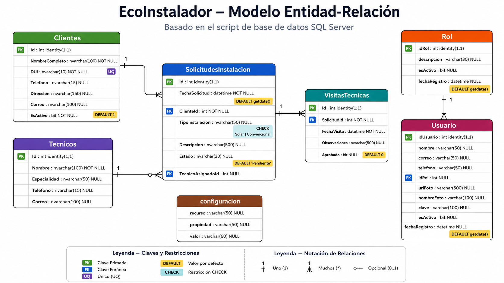

# Modelo de Base de Datos

Este documento describe la estructura relacional principal del sistema **EcoInstalacion**, orientado a la gestión de solicitudes de instalación eléctrica y solar.

## Diagrama relacional

## Entidades principales

### Clientes

Representa a los clientes que solicitan servicios de instalación o asistencia técnica.

Campos principales:

- `Id`
- `NombreCompleto`
- `DUI`
- `Telefono`
- `Direccion`
- `Correo`
- `EsActivo`

### SolicitudesInstalacion

Representa el núcleo operativo del sistema. Cada solicitud pertenece a un cliente y puede estar asignada a un técnico.

Campos principales:

- `Id`
- `FechaSolicitud`
- `ClienteId`
- `TipoInstalacion`
- `Descripcion`
- `Estado`
- `TecnicoAsignadoId`

### Tecnicos

Representa a los técnicos disponibles para atender solicitudes de instalación o visitas técnicas.

Campos principales:

- `Id`
- `Nombre`
- `Especialidad`
- `Telefono`
- `Correo`

### VisitasTecnicas

Representa las visitas asociadas a una solicitud de instalación.

Campos principales:

- `Id`
- `SolicitudId`
- `FechaVisita`
- `Observaciones`
- `Aprobado`

### Rol

Representa el catálogo de roles utilizados por los usuarios del sistema.

Campos principales:

- `idRol`
- `descripcion`
- `esActivo`
- `fechaRegistro`

### Usuario

Representa a los usuarios internos del sistema y su relación con un rol.

Campos principales:

- `idUsuario`
- `nombre`
- `correo`
- `telefono`
- `idRol`
- `urlFoto`
- `nombreFoto`
- `clave`
- `esActivo`
- `fechaRegistro`

## Relaciones principales

- Un **Cliente** puede tener múltiples **SolicitudesInstalacion**.
- Una **SolicitudInstalacion** pertenece a un **Cliente**.
- Una **SolicitudInstalacion** puede estar asignada a un **Tecnico**.
- Un **Tecnico** puede estar asociado a múltiples **SolicitudesInstalacion**.
- Una **SolicitudInstalacion** puede tener múltiples **VisitasTecnicas**.
- Una **VisitaTecnica** pertenece a una **SolicitudInstalacion**.
- Un **Rol** puede estar asociado a múltiples **Usuarios**.
- Un **Usuario** pertenece a un **Rol**.

## Observaciones arquitectónicas

El modelo relacional confirma que la entidad central del dominio operativo es **SolicitudesInstalacion**, ya que conecta clientes, técnicos y visitas técnicas.

Esta estructura respalda la estrategia API-first adoptada durante la modernización progresiva del sistema:

- `Clientes` ya cuenta con API REST.
- `Tecnicos` ya cuenta con API REST.
- `Roles` ya cuenta con API REST.
- `SolicitudesInstalacion` es el siguiente módulo natural para exponer mediante API REST.

## Criterio de modernización

El diagrama permite visualizar que el backend puede avanzar progresivamente hacia una arquitectura preparada para **React + Vite** sin alterar de forma abrupta el sistema MVC/Razor existente.

La estrategia recomendada es continuar creando endpoints REST por módulo, usando DTOs y mapeo manual, manteniendo separadas las responsabilidades entre presentación, lógica de negocio y acceso a datos.